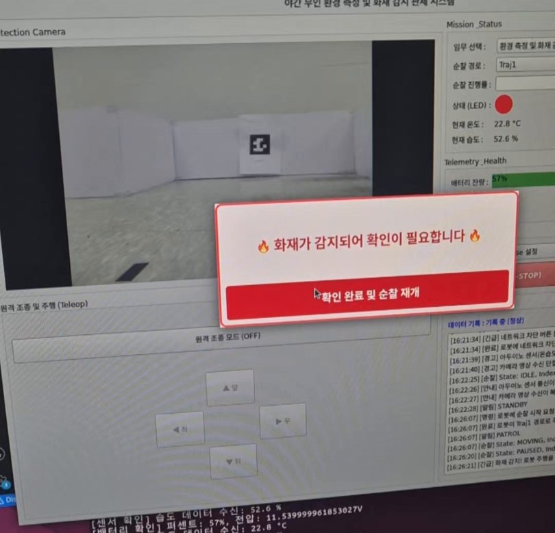
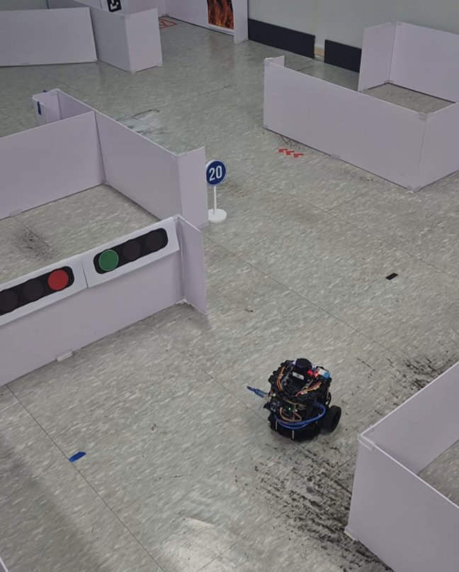
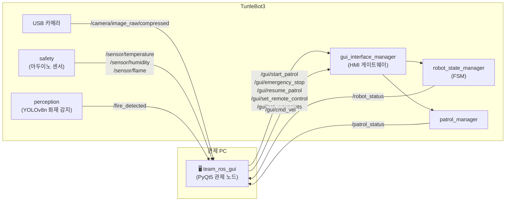
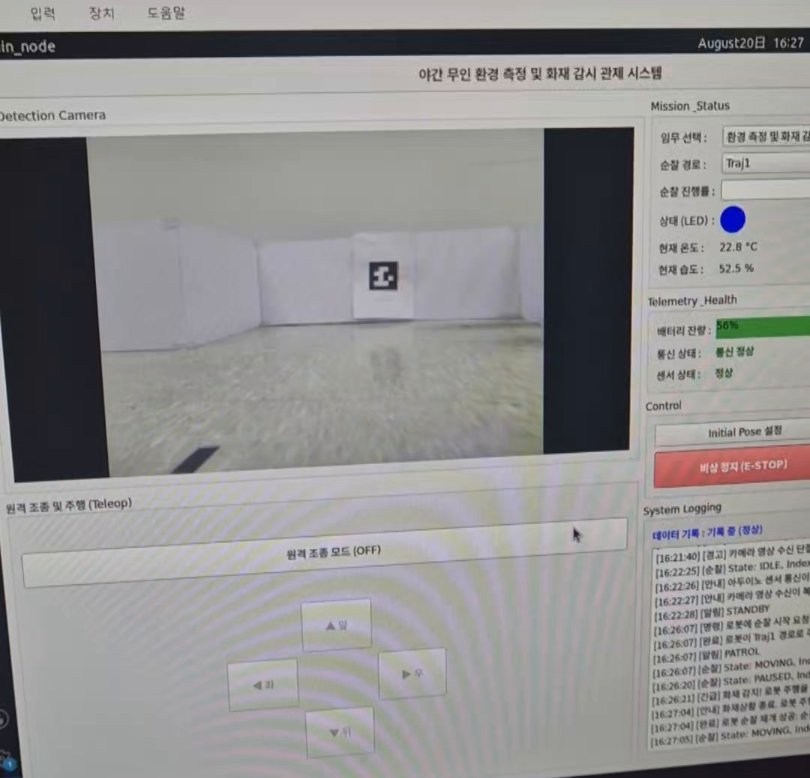
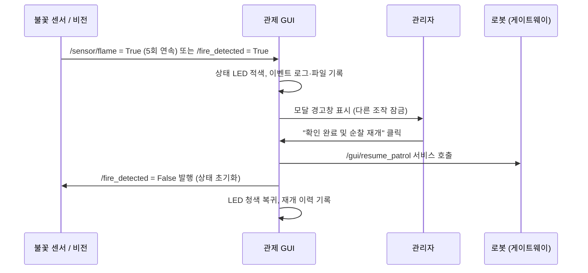

# 🔥 TurtleBot3 야간 화재감시 순찰 로봇 — 관제 GUI 개발

> ROS 2 Humble 기반 자율 순찰·화재감시 로봇의 **PyQt5 실시간 관제 시스템**을 설계하고 구현했습니다.
> 3인 팀 프로젝트에서 **GUI / 원격제어 파트**를 맡았습니다.

<p align="center">
  
  
</p>
<p align="center"><sub>왼쪽: 화재 감지 시 관제 화면 (상태 LED 적색 전환 + 모달 경고) · 오른쪽: 테스트 코스를 순찰 중인 TurtleBot3</sub></p>

---

## 📌 한눈에 보기

| 항목 | 내용 |
| :--- | :--- |
| 프로젝트 | 야간 무인 환경 측정 및 화재 감시 순찰 로봇 |
| 기간 | 2026.07.20 ~ 2026.08.21 (교육과정 팀 프로젝트) |
| 인원 | 3명 (시스템 통합·자율주행·비전 / 센서·하드웨어 / **GUI·원격제어 — 본인**) |
| 플랫폼 | TurtleBot3 Burger, Raspberry Pi 4, Arduino (온습도·불꽃·가스 센서), USB 카메라 |
| 본인 담당 | `team_ros_gui` 패키지 전체 — 관제 화면 설계, ROS 2 통신 연동, 원격 조종(데드맨 스위치), 이상 상황 감지·알림 |
| 사용 기술 | `Python 3.10` `ROS 2 Humble` `PyQt5` `OpenCV` `cv_bridge` `rclpy` `PyYAML` `Git Flow` |

---

## 🧭 프로젝트 개요

야간에 사람 없이 시설을 순찰하며 **온습도를 측정하고 화재를 감시**하는 로봇입니다.
로봇은 FSM(유한 상태 머신)으로 상태를 관리하며 Nav2로 경유점을 순찰하고, YOLOv8n 비전 모델과 아두이노 불꽃 센서로 화재를 감지합니다. 순찰이 끝나면 ArUco 마커를 인식해 충전 스테이션에 정밀 도킹합니다.

관리자는 **관제 GUI 하나로** 로봇의 카메라 영상, 상태, 센서 값, 배터리를 실시간으로 확인하고 순찰 시작·비상 정지·원격 조종을 할 수 있습니다. 이 관제 GUI가 제가 맡은 부분입니다.

---

## 🏗️ 시스템 구조와 GUI의 위치

GUI는 로봇 내부 로직(FSM, 순찰 관리자)에 직접 명령하지 않고, **HMI 게이트웨이 노드**(`gui_interface_manager`)가 제공하는 `/gui/*` 서비스만 호출하도록 설계했습니다. 화면 로직과 로봇 핵심 로직이 분리되어 있어, 팀원이 내부 구조를 바꿔도 GUI 코드를 고칠 필요가 없었습니다.



---

## 🖥️ 관제 화면 구성

<p align="center">
  
</p>

화면을 **좌 6 : 우 4** 비율로 나누어, 관리자가 가장 오래 보는 카메라 영상을 크게 배치했습니다.

| 영역 | 그룹 | 기능 |
| :--- | :--- | :--- |
| 좌측 상단 | Fire Detection Camera | 실시간 카메라 스트리밍, 카메라 단절 시 화면에 경고 표시 |
| 좌측 하단 | 원격 조종 (Teleop) | 원격 모드 ON/OFF, 십자 방향 버튼 (데드맨 스위치 방식) |
| 우측 1 | Mission & Status | 임무·순찰 경로 선택, 순찰 진행률, 상태 LED, 온도·습도 |
| 우측 2 | Telemetry & Health | 배터리 잔량, 통신 상태, 센서 상태 |
| 우측 3 | Control | Initial Pose 설정, 순찰 시작, **비상 정지(E-STOP)**, 네트워크 40초 차단 테스트 |
| 우측 4 | System Logging | 타임스탬프가 붙은 이벤트 로그, 데이터 기록 상태 |

---

## 💡 구현 내용

### 1. 기능별 핸들러로 나눈 GUI 구조

하나의 파일에 모든 기능이 몰리지 않도록, 화면(`main.py`)과 ROS 노드(`main_node.py`)를 분리하고 기능별로 **핸들러 5개**를 만들었습니다. ROS 콜백은 데이터를 받아 해당 핸들러에 넘기기만 하고, 화면을 어떻게 바꿀지는 핸들러가 결정합니다.

```
team_ros_gui/
├── main.py                 # PyQt5 화면 레이아웃 (MainWindow)
├── main_node.py            # ROS 2 노드: 구독·발행·서비스 호출
└── ros_workers/
    ├── handler_visual.py     # 카메라 프레임 변환·표시, 카메라 타임아웃
    ├── handler_status.py     # 상태 LED, 온습도, 순찰 진행률, Heartbeat
    ├── handler_telemetry.py  # 배터리, 센서 상태
    ├── handler_control.py    # 버튼·시그널 연결, 순찰 경로 로드
    └── handler_logging.py    # 이벤트 로그, CSV·TXT 기록
```

### 2. GUI가 멈추지 않는 ROS 2 연동 (비동기 처리)

PyQt 이벤트 루프와 ROS 2 스핀을 한 프로세스에서 함께 돌려야 했습니다. `QTimer`로 30ms마다 `spin_once`를 호출해 두 루프를 하나로 묶었고, 모든 서비스 호출은 `call_async` + 콜백으로 처리했습니다. 로봇이 응답하는 동안에도 화면이 멈추지 않고 영상과 센서 값이 계속 갱신됩니다.

```python
# ROS 2 스핀을 Qt 이벤트 루프 안에서 실행
self.ros_timer = QTimer()
self.ros_timer.timeout.connect(self.spin_ros)   # rclpy.spin_once(self, timeout_sec=0)
self.ros_timer.start(30)

# 서비스는 비동기로 호출하고 결과는 콜백에서 처리
future = self.start_patrol_client.call_async(req)
future.add_done_callback(self.start_mission_callback)
```

서비스가 아직 준비되지 않았을 때는 `service_is_ready()`로 먼저 확인해 로그로 알려주고, 순찰 경로 서비스는 1초 주기로 재시도하다가 연결되면 타이머를 멈추도록 했습니다.

### 3. 데드맨 스위치 방식 원격 조종

원격 조종 중 통신이 끊기거나 손을 떼면 로봇이 바로 멈춰야 합니다. 방향 버튼을 **누르고 있는 동안만** 속도 명령을 보내고, 손을 떼는 순간 정지 명령을 보내도록 구현했습니다.

```python
self.btn_up.pressed.connect(lambda: self.sig_cmd_vel.emit(0.2, 0.0))   # 누르는 동안 전진
self.btn_up.released.connect(lambda: self.sig_cmd_vel.emit(0.0, 0.0))  # 떼면 즉시 정지
```

- 원격 조종 모드가 **OFF일 때는 방향 버튼을 비활성화**해 오조작을 막았습니다.
- 모드 전환은 `SetRemoteControl` 서비스로 로봇 측에 요청해, 로봇이 원격 조종 상태로 전환되도록 했습니다.

### 4. 화재 감지 알림과 순찰 재개 흐름



- **센서 오탐 방지:** 불꽃 센서 값이 순간적으로 튀는 경우가 있어, **5회 연속** 감지될 때만 경보를 띄우고 중간에 한 번이라도 미감지가 오면 카운트를 초기화했습니다. 비전 모델의 감지 결과(`/fire_detected`)는 이미 판정된 값이라 즉시 반영했습니다.
- **중복 경보 방지:** 경보가 떠 있는 동안에는 추가 감지가 와도 다시 띄우지 않습니다.
- **모달 경고창:** 테두리 없는 모달 다이얼로그로 띄워, 관리자가 확인하기 전에는 다른 버튼을 누를 수 없게 했습니다.

### 5. 통신·센서·카메라 이상 감지

로봇과 원격으로 연결된 관제 화면은 "데이터가 안 오는 상태"를 스스로 알아차려야 합니다. 마지막 수신 시각을 기록하고 타이머로 경과 시간을 확인하는 방식으로 세 가지 단절을 감지했습니다.

| 감지 대상 | 기준 | 화면 반응 |
| :--- | :--- | :--- |
| 로봇 통신 (Heartbeat) | 3초 이상 미수신 | "통신 단절 (3초 초과!)" 적색 표시, LED 회색 |
| 카메라 영상 | 3초 이상 미수신 | 영상 영역에 "카메라 신호 끊김" 경고, 로그 기록 |
| 아두이노 센서 (온습도·불꽃) | 2초 이상 미수신 | 센서 상태 "센서 이상 감지!", 온습도 0으로 초기화 |

- 한 번도 연결된 적 없는 상태("연결 안됨")와 연결 후 끊긴 상태("센서 이상")를 구분해 표시했습니다.
- 끊겼다가 다시 들어오면 "복구되었습니다" 로그를 남겨, 단절 구간을 로그만 보고도 알 수 있게 했습니다.
- 같은 경고가 1초마다 반복 기록되지 않도록 상태 플래그로 한 번만 기록합니다.

### 6. 그 밖의 기능

- **카메라 스트리밍 최적화:** 압축 이미지(`CompressedImage`)를 `cv_bridge`로 변환하고, 2프레임 중 1프레임만 그려 관제 PC 부하를 줄였습니다. BGR→RGB 변환 후 `QImage`로 바꿔 비율을 유지한 채 표시합니다.
- **순찰 경로 동적 로드:** 경로를 GUI에 하드코딩하지 않고, `GetWaypoints` 서비스로 로봇의 경유점 YAML을 받아 콤보박스를 채웁니다. 로봇 측 경로 파일만 바꾸면 GUI에 자동 반영됩니다.
- **순찰 진행률:** 현재 경유점 인덱스로 진행률을 계산하되, 값이 뒤로 가지 않도록 증가할 때만 갱신하고 완료 상태에서는 100%로 고정했습니다.
- **배터리 경고:** 잔량이 35% 이하로 떨어지면 배터리 바를 적색으로 바꿉니다.
- **기록:** 모든 로그에 타임스탬프를 붙이고, 환경 측정값은 CSV, 이상 상황 이력은 TXT로 로컬에 저장합니다 (외부 클라우드 사용 금지 조건 반영).

---

## 🧪 테스트

팀에서 작성한 요구사항 명세서의 항목 번호(예: UR-016 순찰 진행률, UR-038 통신 단절)를 코드 주석에 남겨 요구사항과 구현을 연결했고, 실제 로봇으로 아래 시나리오를 시험했습니다.

| 시나리오 | 확인 내용 |
| :--- | :--- |
| 순찰 시작 | 경로 선택 → 순찰 시작 → 진행률·상태 LED·로그 갱신 |
| 화재 감지 | 불꽃 센서·비전 감지 시 경고창 표시 → 확인 후 순찰 재개 |
| 비상 정지 | E-STOP 버튼으로 순찰 강제 정지 |
| 원격 조종 | 원격 모드 ON → 방향 버튼 조작 → OFF 후 순찰 재개 |
| 네트워크 단절 | GUI의 "네트워크 40초 차단" 요청 → 통신 단절 표시 → 로봇 시작 지점 복귀 확인 |
| 센서·카메라 단절 | 아두이노·카메라 연결 해제 시 경고 표시, 재연결 시 복구 로그 |

---

## 🤝 협업 방식

- **Git Flow 브랜치 전략:** `main` / `develop` / `feature/*` 로 나누어 각자 기능 브랜치에서 작업하고 `develop`에 병합했습니다.
- **Rebase로 최신 코드 유지:** `develop`의 최신 코드를 주기적으로 내 브랜치에 rebase해 충돌을 작게 유지했고, stash·충돌 해결 절차를 정리해 두고 작업했습니다.
- **인터페이스 우선 합의:** GUI가 사용할 토픽·서비스 이름과 메시지 형식(`RobotStatus`, `PatrolStatus` 등)을 먼저 정한 뒤 각자 개발해, 통합 단계의 수정을 줄였습니다.

---

## 📝 배운 점

- **GUI 프레임워크와 ROS를 함께 쓸 때 핵심은 "멈추지 않는 것"이었습니다.** 로봇 응답을 기다리는 동기 호출 하나가 화면 전체를 멈추게 할 수 있어, 서비스 호출을 모두 비동기 + 콜백 구조로 설계했습니다.
- **관제 화면은 정상 상태보다 이상 상태를 보여주는 게 더 중요합니다.** 데이터가 "안 오는" 상황을 감지하는 타임아웃 로직이 네트워크·센서 단절 시나리오 시험의 핵심이었습니다.
- **역할을 나눈 코드 구조가 협업을 쉽게 만듭니다.** 핸들러 분리와 게이트웨이 노드 덕분에 팀원과 파일 충돌 없이 병렬로 개발할 수 있었습니다.

---

<sub>※ 팀 저장소는 비공개이므로, 이 저장소에는 본인 담당 파트를 중심으로 설명과 핵심 코드 일부만 정리했습니다.</sub>
